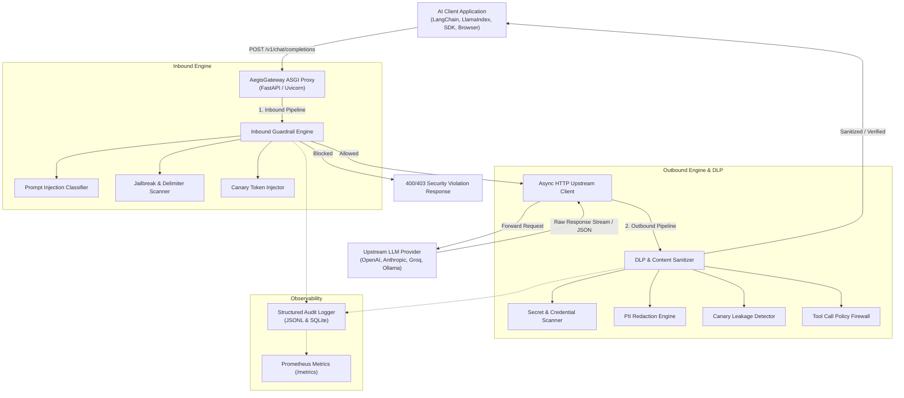
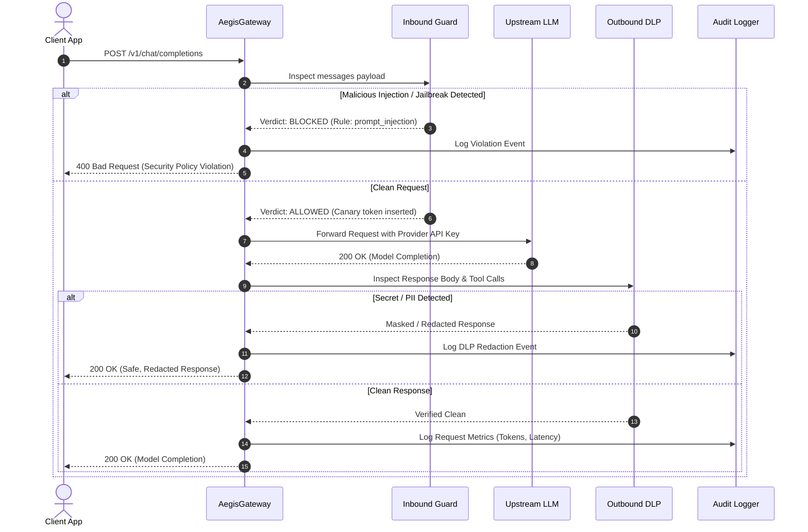

# AegisGateway System Architecture

## 1. Executive Summary

**AegisGateway** is an enterprise-grade, high-performance security reverse proxy and Data Loss Prevention (DLP) gateway designed for Large Language Model (LLM) applications and autonomous AI agents. 

It drops transparently between AI client applications (SDKs, IDEs, Web UIs) and LLM providers (OpenAI, Anthropic, Groq, Ollama, vLLM), providing bidirectional security enforcement:

1. **Inbound Guardrails**: Neutralizes prompt injections, roleplay jailbreaks, delimiter escapes, and system prompt extraction attacks before they reach the model.
2. **Outbound Guardrails (DLP)**: Inspects model completions for sensitive corporate credentials (AWS, GitHub, JWT, Private Keys), PII (SSN, emails, credit cards), and leaks of internal system canary tokens.
3. **Tool Execution Firewall**: Inspects agent tool calls (`tools/call`) to prevent unauthorized file access, destructive shell executions, and server-side request forgery (SSRF).

---

## 2. End-to-End System Architecture

---

## 3. Request & Response Sequence Flow

---

## 4. Component Architecture & Responsibilities

| Component | Module | Responsibility |
| :--- | :--- | :--- |
| **Proxy Router** | `aegis.api.router` | Exposes standard OpenAI-compatible endpoints (`/v1/chat/completions`, `/v1/models`, `/healthz`, `/metrics`). |
| **Inbound Engine** | `aegis.engine.inbound` | Analyzes prompt messages for delimiter attacks, roleplay jailbreaks, refusal suppression, and injects session canaries. |
| **Outbound Engine** | `aegis.engine.outbound` | Scans completions for API keys, private keys, PII, and applies redaction/masking policies. |
| **Tool Firewall** | `aegis.engine.tools` | Inspects agent function calls (`tool_calls`) for path traversal (`/etc/passwd`, `.env`), destructive bash commands (`rm -rf`), and network SSRF. |
| **Policy Engine** | `aegis.core.policy` | Loads, compiles, and evaluates YAML security policies with hot-reloading support. |
| **Audit & Metrics** | `aegis.core.audit` | Records structured JSONL security audit events and exports Prometheus metrics. |

---

## 5. Security & Trust Boundaries

1. **Client Boundary**: Untrusted input received over HTTP/TLS. Rate limited and strictly validated using Pydantic models.
2. **Gateway Core**: Memory-safe parsing. Zero shell execution, zero dynamic evaluation. Regex patterns are pre-compiled with timeout protections.
3. **Upstream LLM Boundary**: Gateway manages upstream provider API credentials in memory. Client never needs direct access to upstream master keys.
4. **Audit Trail**: Sensitive payloads are hashed or masked in audit logs to prevent secondary data exposure.
